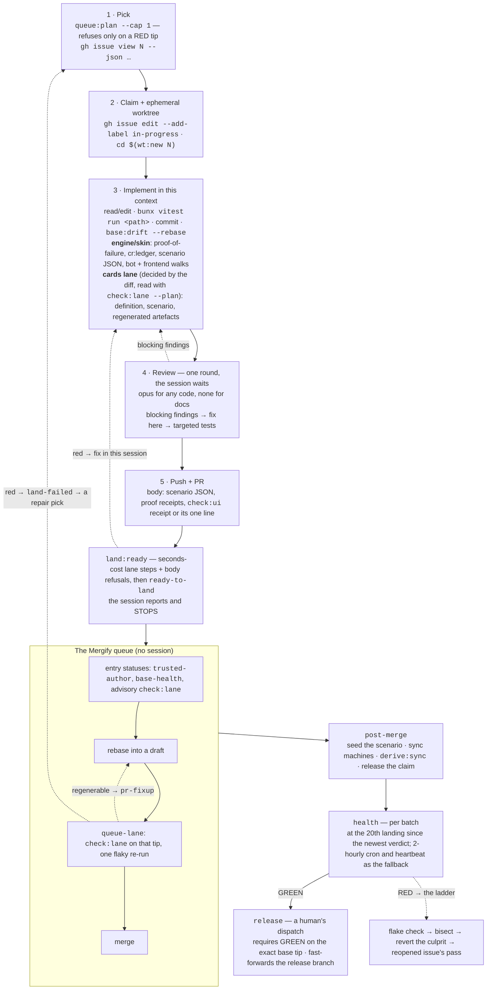

# The `/next-ticket` flow

What one session does from `/next-ticket` to a merged PR, and what the pipeline
does from there. The stages are `.claude/skills/next-ticket/SKILL.md`; the jobs are
[GitHub pipeline](github-pipeline.md). Re-derive any number with
`bun run telemetry:latency`.

## 1. One session, one issue

Step 3's two paths are chosen by the classifier, never by the session:
`bun run check:lane --plan` prints the lane and runs nothing. A session that finds
itself writing a test on a `cards` diff has found an unexercised Op and stops
(`/new-op`).

A session never runs the lane before the hand-off (ADR 0136 §1): the base moves
under a pre-PR gate, and it would be paid twice. `land:ready`'s seconds-cost steps
catch what the session can still fix for free.

## 2. The rules of a RED

- **Who sees it**: `health` writes the `health` commit status on the gated sha.
  `queue:plan` and [`base-health`](github-pipeline.md#g-base-health) read
  it through the verdict store, on every machine.
- **What stops**: new picks, and the queue for every PR that is not a declared
  repair. A queued PR is [held](github-pipeline.md#a-red-dequeue-is-a-hold), never
  blamed, and the GREEN requeues it. A session mid-issue finishes and hands off.
- **What runs**: the [RED ladder](github-pipeline.md#g-red-ladder) reverts a named
  culprit first; fix-forward is the reopened issue's pass (ADR 0158). `health-fix`
  takes what it cannot name, `bun run health:fix` by hand. A declared repair's tip
  is proven by the RED's own evidence (ADR 0156 Amendment V).
- **Coverage**: health gates the tip current at its start, so one run covers
  everything landed meanwhile.

## 3. Project skills only — the one local step

Tolaria's skills are the project skills (ADR 0150): committed
`.claude/settings.json` disables the `superpowers` plugin and hides every
machine-level skill, and `scripts/__tests__/project-skills.test.ts` fails on a
machine-level skill that is neither hidden nor a project skill — add
`"<name>": "off"` under `skillOverrides` (or adopt the skill into
`.claude/skills/` by copying it in).

Skills synced from the owner's claude.ai account (`~/.claude/skills/synced/`)
cannot be switched off from committed settings. If one shows up in a session,
hide it locally, once, in `.claude/settings.local.json` (gitignored):
`{ "skillOverrides": { "<name>": "off" } }`. Not gated.

## 4. AFK: the same flow, in jobs

[`afk-dispatch`](github-pipeline.md#afk-dispatch) picks as many issues as there
are free `pass` runners, claims each and dispatches
[`afk-pass`](github-pipeline.md#afk-pass), which runs `/next-ticket` for that one
issue ([A pass inside a job](github-pipeline.md#a-pass-inside-a-job),
`.claude/skills/next-ticket/job.md`). When a pass ends, it dispatches the
dispatcher again.

- **Parallelism** is the number of `pass` runners online. Pause a machine with
  `bun run runner pause`; the other carries the queue.
- **Depth**: no new pick while `ready-to-land` PRs reach `afkDispatch.queueMax`,
  repairs only past `afkDispatch.failedMax` (issue #6988).
- **A dead pass** is resumed by the dispatcher from its pushed branch.
- **Watching**: the Actions tab, `bun run cockpit`, `bun run runner status`.
